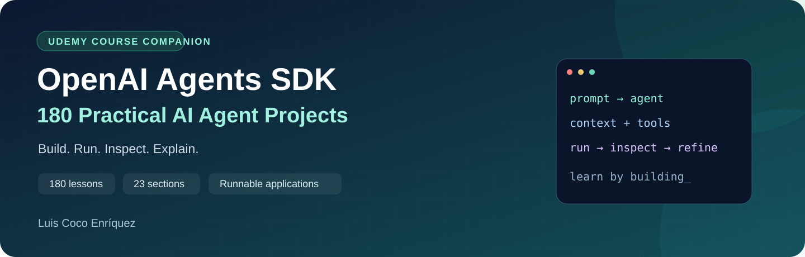
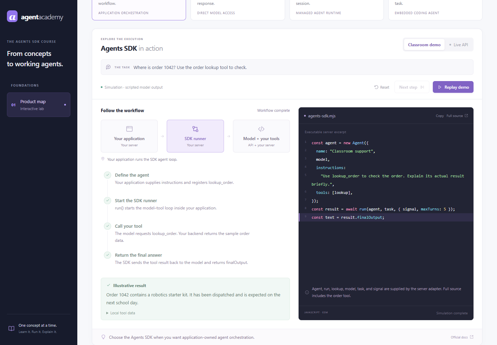
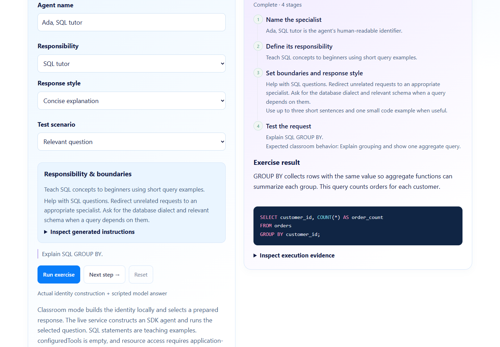

<p align="center"></p>

# OpenAI Agents SDK: 180 Practical AI Agent Projects

**Turn agent concepts into working applications—one focused, hands-on lesson at a time.**

[](docs/CURRICULUM.md)
[](docs/CURRICULUM.md)
[](apps/package.json)
[](docs/GETTING_STARTED.md)

**Instructor: Luis Coco Enríquez · Udemy course companion**

[Start your first application](#run-your-first-application) · [Explore all 180 lessons](docs/CURRICULUM.md) · [Student setup guide](docs/GETTING_STARTED.md) · [Get help](https://github.com/luiscoco/Udemy-OpenAI-Agent-SDK/issues)

## Build more than a chatbot

An agent application needs more than a clever prompt. It needs clear responsibilities, useful tools, context, execution controls, observable behavior, and a way to recover when something goes wrong.

This repository accompanies **180 guided lessons across 23 course sections**. Start with your first agent, then work through function tools, databases, structured outputs, streaming, MCP, specialist handoffs, memory, guardrails, human approval, sandbox workspaces, tracing, voice, testing, and reliability.

Every core prompt maps to an application you can run and inspect. Change the inputs, compare scenarios, read the source, and use execution evidence to explain the result.

> **Learn the concept. Run the application. Change one thing. Explain what happened.**

## What makes this course practical?

| Inside the lessons | How it helps you learn |
| --- | --- |
| Runnable applications | Move from a written requirement to observable behavior. |
| Interactive controls and scenarios | Test a prediction instead of accepting a single answer. |
| Syntax-highlighted source explorers | Connect the demonstration to the implementation. |
| Execution evidence | Inspect configuration, tool results, decisions, and state. |
| Knowledge checks and exercises | Practice explaining why the application behaves as it does. |
| Clearly labeled execution modes | Distinguish classroom fixtures, actual local SDK work, and live services. |
| A consistent learning sequence | Build understanding progressively, then revisit a topic by prompt number. |

The Udemy lessons pair these applications with visual explanations and guided demonstrations. **This GitHub repository contains the source and student documentation; the video library and instructor rendering files are distributed separately.**

## See the applications

<p align="center"></p>

<p align="center"></p>

## What you will build and explore

- **Agent foundations:** identity, instructions, dynamic configuration, context, and dependency injection.
- **Useful tools:** validated arguments, external APIs, database operations, failure handling, and tool policies.
- **Coordinated workflows:** routing, handoffs, managers, specialists, parallel execution, and state machines.
- **Stateful experiences:** sessions, persistent history, context compaction, and application memory.
- **Controlled execution:** guardrails, approval interfaces, paused runs, and safe resumption.
- **Developer workflows:** sandbox capabilities, files, skills, artifacts, hooks, traces, and operational metrics.
- **Interactive interfaces:** streaming, realtime voice, speech pipelines, and telephony concepts.
- **Reliable systems:** deterministic tests, evaluation datasets, regressions, retries, timeouts, and execution budgets.

See the [complete curriculum](docs/CURRICULUM.md) for the exact lesson-to-application mapping.

## Run your first application

Install **Git** and **Node.js 24 or later**. Open Windows Terminal with PowerShell:

```powershell
git clone https://github.com/luiscoco/Udemy-OpenAI-Agent-SDK.git
Set-Location .\Udemy-OpenAI-Agent-SDK\apps
npm ci
npm run lesson:5
```

Open **http://127.0.0.1:3105**. Keep the terminal running and press **Ctrl+C** to stop the application.

To choose another shared-runtime lesson:

```powershell
npm run lesson:9
```

Open **http://127.0.0.1:3109**. The launch scripts run from `lesson:2` through `lesson:200`; the core course covers **1–180**. The default port is **3100 + the prompt number**.

### Prompt 1 has its own application

From the repository root:

```powershell
Set-Location .\apps\prompt-001-product-map
npm ci
npm start
```

Open **http://127.0.0.1:3101**.

For Python-dependent lessons, optional live configuration, port changes, and troubleshooting, follow the [student setup guide](docs/GETTING_STARTED.md).

## Start in classroom mode

Begin with the application's default **classroom mode**. It uses the local fixtures and execution scope described in each lesson, so you can study many workflows without making paid model calls. Some exercises execute the real local SDK; others deliberately illustrate service behavior with controlled fixtures.

Live model calls and hosted-service features are optional and depend on your account, model access, and the selected lesson. They may incur usage charges. Python exercises and optional Docker/provider demonstrations have additional setup requirements.

**Classroom behavior is labeled in the interface. Read that label when interpreting a result.** A simulated service response is a teaching fixture, not evidence that a hosted service was called.

## Your learning path

| Stage | Lessons | Focus |
| --- | --- | --- |
| Foundations | 1–32 | Agent setup, instructions, context, structured and multimodal inputs |
| Execution and tools | 33–88 | Models, runs, streaming, function tools, retrieval, and MCP |
| Agent workflows | 89–128 | Handoffs, orchestration, memory, guardrails, and human approval |
| Workspaces and observability | 129–152 | Sandboxes, capabilities, skills, tracing, and hooks |
| Voice experiences | 153–168 | Realtime agents, audio pipelines, and voice integrations |
| Testing and reliability | 169–180 | Evaluation, regressions, retries, deadlines, and background jobs |

Applications **181–200** are also included as supplementary reference exercises. They are outside the 180-lesson core curriculum and its video numbering.

## Practice with a repeatable method

1. Read the implementation prompt and learning objective.
2. Predict the result for the first scenario.
3. Run the application and inspect its execution scope and evidence.
4. Find the corresponding source code.
5. Change one relevant input and compare the second scenario.
6. Answer the knowledge check and explain your reasoning.

Keep a small learning journal: **input → prediction → observed result → supporting evidence**. This gives you a useful record of what you have understood and what you want to investigate next.

## Repository layout

```text
apps/
  package.json                  Shared launch scripts and pinned dependencies
  foundations-runtime/          Shared server, examples, course modules, and tests
  prompt-001-product-map/       Standalone Prompt 1 application
  prompt-002-.../                Per-prompt launchers and documentation
  ...
  prompt-200-.../                Supplementary application
docs/
  CURRICULUM.md                 All 23 sections and 180 lesson links
  GETTING_STARTED.md            Windows setup, execution modes, and troubleshooting
  assets/                       Course banner and application screenshots
```

The applications share infrastructure to keep installation and navigation consistent. They are focused teaching labs, not a claim that each folder is a separate production-ready product.

## Who this is for

Developers, technical educators, and hands-on learners who want to understand how agent applications work. Basic JavaScript or TypeScript, familiarity with APIs, and comfort using a terminal will help. Python familiarity is useful for the Python examples.

## Continue learning and share your progress

Use this repository alongside the Udemy course, revisit the [curriculum](docs/CURRICULUM.md), and adapt the exercises to a problem you care about.

If the applications help you learn, **star the repository** so you can find it again, share it with a study partner, and leave an honest course review on Udemy. For a reproducible issue, include the prompt number, your Node.js version, the scenario, and the error message—without API keys or private data.

**Created by [Luis Coco Enríquez](https://github.com/luiscoco).** This is an independent educational course. OpenAI and Udemy names and marks belong to their respective owners.
